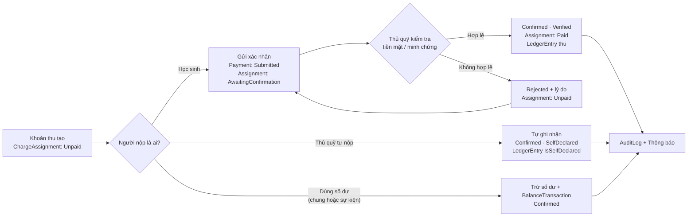
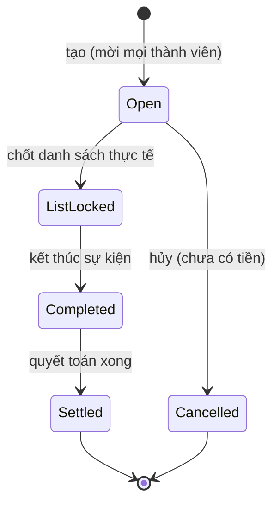

# Quy tắc nghiệp vụ & quy trình

> Mã `BR-xx` được trích trong code (comment), test (tên test) và module plan. Quy tắc đã có hàm dùng chung ở Domain ghi rõ ở cột "Cài đặt".

## 1. Quy tắc nghiệp vụ

### 1.1. Phạm vi tài chính

| Mã | Quy tắc | Cài đặt |
|---|---|---|
| BR-01 | Mỗi khoản thu, giao dịch, thông báo, dòng audit thuộc đúng **một** phạm vi: Quỹ chung (`EventId = null`) hoặc một Sự kiện (`EventId` có giá trị). | Cột `EventId` nullable – không thể "vừa chung vừa sự kiện". `FinancialScope` cho Notification/AuditLog. |
| BR-02 | Số liệu quỹ chung **không** gồm giao dịch sự kiện và ngược lại. Mọi truy vấn báo cáo phải lọc theo `EventId`. | Module M13 |
| BR-03 | Không lấy quỹ chung bù thiếu sự kiện, không chuyển tiền thừa sự kiện vào quỹ chung. Không có API chuyển tiền giữa hai phạm vi. | – |
| BR-04 | Quỹ chung không quyết toán theo hoạt động; thiếu tiền thì tạo khoản thu bổ sung chung; số dư giữ tới tổng kết cuối năm. | M6, M13 |

### 1.2. Tiền & chứng từ

| Mã | Quy tắc | Cài đặt |
|---|---|---|
| BR-05 | Tiền là số nguyên VND > 0 (tối đa 100 tỷ). | `MoneyRule`, CHECK trong DB |
| BR-06 | Giao dịch **> 500.000đ** bắt buộc chứng từ; ≤ 500.000đ tùy chọn. | `EvidenceRule.EnsureProvided` |
| BR-07 | File lưu trên Neon Object Storage, giới hạn theo loại: hóa đơn & bill chuyển khoản (ảnh/PDF ≤ 5 MB), ảnh đại diện (ảnh ≤ 2 MB), tài liệu (PDF/Word/Excel/ảnh ≤ 10 MB). Khóa lưu ngẫu nhiên `{kind}/{fundId}/{guid}.ext`, không dùng tên file gốc làm đường dẫn; tải file qua API có kiểm quyền. | `FileRule`, `StorageKeys`, `IFileStorage` |
| BR-08 | Sổ thu chi chỉ ghi thêm. Sửa sai = bút toán đảo (`ReversesEntryId`) + lý do; một dòng chỉ bị đảo một lần. | Trigger append-only (migration), M7 |
| BR-09 | Ngày giao dịch không ở tương lai (theo giờ VN). | `VietnamTime`, M7 |

### 1.3. Thanh toán

| Mã | Quy tắc | Cài đặt |
|---|---|---|
| BR-10 | Học sinh: gửi xác nhận (Submitted) → thủ quỹ kiểm tra → Confirmed / Rejected (bắt buộc lý do). Chỉ Confirmed mới sinh `LedgerEntry` thu. | M6 |
| BR-11 | Chuyển khoản phải có ảnh minh chứng (Attachment `PaymentProof`); tiền mặt không bắt buộc. | M6 |
| BR-12 | Thủ quỹ tự nộp cho mình: gửi + tự xác nhận trong một thao tác, `ConfirmationMode = SelfDeclared`, `LedgerEntry.IsSelfDeclared = true`, audit `IsSelfAction = true`. Không cần thủ quỹ khác. | `PaymentConfirmationPolicy` |
| BR-13 | Báo cáo tách riêng thu tự ghi nhận của thủ quỹ (OQ-01). Thủ quỹ chịu trách nhiệm bù nếu khai sai. | M13 |
| BR-14 | Mỗi nghĩa vụ chỉ có một lần nộp đang chờ/đã xác nhận; bị từ chối được nộp lại (OQ-06). | Unique index `UX_Payment_OneActivePerAssignment` |
| BR-15 | Đóng bằng số dư cá nhân (khoản thu **chung hoặc sự kiện**, OQ-10): số dư ≥ số phải đóng và không có yêu cầu rút đang chờ; trừ số dư + `BalanceTransaction(ChargePayment)` + Payment `PersonalBalance` xác nhận ngay (tiền đã nằm trong tay thủ quỹ) + `LedgerEntry` thu vào đúng phạm vi của khoản thu – cùng một transaction. | `WithdrawalRule.EnsureCanSpend`, M6 + M10 |

### 1.4. Sự kiện & quyết toán

| Mã | Quy tắc | Cài đặt |
|---|---|---|
| BR-16 | Vòng đời: `Open → ListLocked → Completed → Settled`; `Open → Cancelled` (chỉ khi chưa có tiền thu/chi). Không quay lui. | `EventStatusRules` |
| BR-17 | Tạo sự kiện ⇒ mời mọi thành viên Active (EventParticipant `Pending`). Thành viên thêm sau được mời khi sự kiện còn `Open`. | M8 |
| BR-18 | Khoản thu sự kiện áp cho người `Accepted` (trước chốt) hoặc `IsFinal` (sau chốt) (OQ-05). | M6 |
| BR-19 | Chốt danh sách: `IsFinal = true` cho người `Accepted` đã `Paid` đủ các khoản thường của sự kiện (OQ-04); người còn lại bị loại (`ExclusionReason`), nghĩa vụ chưa đóng → `Excluded`. | M8 |
| BR-20 | Sau `Settled` hoặc `Cancelled`: không nhận khoản thu / giao dịch mới. | `EventStatusRules.AcceptsNewMoney` |
| BR-21 | Quyết toán chỉ khi `Completed`; tính trên người `IsFinal`; tổng thu = thu đã xác nhận của sự kiện (gồm tự ghi nhận), tổng chi = chi của sự kiện (trừ bút toán đảo). | M9 |
| BR-22 | Thừa: tổng tiền chia = đúng số thừa (largest remainder, OQ-03). Hoàn trực tiếp → `LedgerEntry` chi `Source=Refund` khi thủ quỹ xác nhận đã hoàn từng người. Cộng số dư → `BalanceTransaction(SettlementCredit)` ngay. | M9 + M10 |
| BR-23 | Thiếu: tạo khoản thu `Supplementary` chia cho người `IsFinal` (chia đều, dư lẻ tương tự BR-22); sự kiện chỉ `Settled` khi đã tạo khoản bổ sung. | M9 |
| BR-24 | Mỗi sự kiện quyết toán một lần (unique `Settlement.EventId`). | DB |

### 1.4b. Quyết toán cuối năm quỹ chung (OQ-13)

| Mã | Quy tắc | Cài đặt |
|---|---|---|
| BR-34 | Quyết toán quỹ chung làm **một lần duy nhất** mỗi quỹ (`Settlement` có `EventId = null`, unique theo quỹ). | `UX_Settlement_OneYearEndPerFund` |
| BR-35 | Điều kiện: quỹ `Active` và mọi sự kiện đã `Settled` hoặc `Cancelled`. | `YearEndRule.EnsureCanClose` |
| BR-36 | Người được chia: mọi thành viên `Active` của quỹ (cả lớp, gồm thủ quỹ). Tổng thu/chi chỉ tính giao dịch quỹ chung. Thừa → hoàn trực tiếp / cộng số dư (chia đều / theo tỷ lệ tổng đã đóng các khoản thu chung); thiếu → khoản thu bổ sung chung. Cách tính dùng chung `SettlementCalculator` với quyết toán sự kiện. | M14 |
| BR-37 | Xong quyết toán → quỹ `Archived`: không nhận khoản thu, giao dịch, sự kiện, thành viên mới (trừ thu khoản bổ sung đã tạo khi thiếu và xác nhận hoàn tiền); vẫn xem báo cáo và rút số dư cá nhân. | `YearEndRule.EnsureFundActive` |

### 1.5. Số dư cá nhân

| Mã | Quy tắc | Cài đặt |
|---|---|---|
| BR-25 | Số dư theo (quỹ, người), không âm, độc lập quỹ chung; mọi thay đổi có `BalanceTransaction` (append-only) ghi `BalanceAfter`. | CHECK + xmin concurrency |
| BR-26 | Rút tiền (OQ-11): rút **một lần toàn bộ** số dư; số tiền yêu cầu = số dư lúc gửi; mỗi người một yêu cầu đang chờ / quỹ; trong khi chờ số dư bị giữ (không dùng đóng khoản thu). Thủ quỹ xác nhận đã trả ⇒ trừ đúng số tiền yêu cầu + `BalanceTransaction(Withdrawal)` + audit; từ chối ⇒ bắt buộc lý do, số dư mở lại. **Không** ghi `LedgerEntry`. | `WithdrawalRule`, `UX_WithdrawalRequest_OnePendingPerUser`, M10 |

> Ghi chú BR-26: số dư cá nhân là tiền thủ quỹ **giữ hộ** (hình thành khi quyết toán sự kiện / cuối năm), không thuộc quỹ chung cũng không thuộc sự kiện. Báo cáo có mục riêng "Tiền giữ hộ = tổng số dư cá nhân". Khi số dư được dùng đóng khoản thu, tiền "chuyển" vào phạm vi của khoản thu đó (BR-15).

### 1.6. Tài khoản & thành viên

| Mã | Quy tắc | Cài đặt |
|---|---|---|
| BR-27 | Email là định danh, chuẩn hóa chữ thường, duy nhất toàn hệ thống. | `EmailAddress`, `UX_User_Email` |
| BR-28 | Mật khẩu 8–128 ký tự, có chữ và số. Mật khẩu tạm 16 ký tự ngẫu nhiên, hiển thị một lần. | `PasswordPolicy`, `Credentials.TemporaryPassword` |
| BR-29 | Đổi mật khẩu / cấp lại mật khẩu tạm / khóa tài khoản ⇒ đổi `SecurityStamp` ⇒ các phiên cũ mất hiệu lực. | `IdentityStore` |
| BR-30 | Ngừng thành viên không xóa dữ liệu lịch sử; thành viên `Removed` mất quyền truy cập quỹ. | `AccessService` |

### 1.7. Thông báo & audit

| Mã | Quy tắc | Cài đặt |
|---|---|---|
| BR-31 | Thông báo tạo cùng transaction với nghiệp vụ; tiêu đề có tiền tố `[Quỹ chung]` / `[Sự kiện: tên]`. | `Notifier` |
| BR-32 | Thông báo khoản thu sự kiện chỉ gửi người tham gia (người có nghĩa vụ). | M6 |
| BR-33 | Mọi thao tác ghi (trừ đọc) ghi `AuditLog` cùng transaction: actor, phạm vi, sự kiện, entity, before/after (JSON), `IsSelfAction`, lý do. Không ghi mật khẩu, hash, token. | `AuditTrail` |

## 2. Quy trình

### 2.1. Thanh toán khoản thu (BR-10 → BR-15)

### 2.2. Vòng đời sự kiện

Trong `Open`: học sinh trả lời tham gia; thủ quỹ tạo khoản thu, ghi chi; học sinh nộp tiền.
Trong `ListLocked`/`Completed`: vẫn ghi chi phát sinh, khoản thu cho người thực tế.

### 2.3. Quyết toán sự kiện

1. Sự kiện `Completed` → thủ quỹ mở màn hình quyết toán, hệ thống tính: số người thực tế, tổng thu, tổng chi, chênh lệch.
2. **Cân bằng** → xác nhận → `Settled`.
3. **Thừa** → chọn phương án (hoàn trực tiếp / cộng số dư) + cách chia (đều / tỷ lệ) → xem trước phần mỗi người → xác nhận:
   - Cộng số dư: cộng ngay, thông báo `BalanceCredited`.
   - Hoàn trực tiếp: `SettlementLine` chờ hoàn; thủ quỹ xác nhận từng người đã nhận tiền (ghi chi `Refund`).
4. **Thiếu** → hệ thống tạo khoản thu bổ sung chia cho người thực tế, thông báo `SupplementaryChargeCreated`.
5. Ghi `Settlement` (EventId = sự kiện), audit, thông báo `SettlementResult` cho người tham gia → sự kiện `Settled`.

### 2.4. Rút số dư (rút toàn bộ một lần)

1. Người dùng (học sinh hoặc thủ quỹ) mở "Số dư cá nhân", bấm **"Rút tiền"** → hệ thống tạo yêu cầu với số tiền = toàn bộ số dư; số dư chuyển trạng thái "đang chờ rút".
2. Thủ quỹ nhận thông báo, liên hệ người dùng và trả tiền mặt / chuyển khoản ngoài hệ thống.
3. Thủ quỹ xác nhận **"Đã hoàn tiền"** → trừ số dư, `BalanceTransaction(Withdrawal)`, audit; hoặc **từ chối** + lý do → số dư mở lại.
4. Người dùng nhận thông báo `WithdrawalProcessed`.

Thủ quỹ rút số dư của chính mình: tự xác nhận được (giống BR-12), audit `IsSelfAction = true`.

### 2.6. Quyết toán cuối năm quỹ chung

1. Mọi sự kiện đã quyết toán / hủy → thủ quỹ mở "Tổng kết cuối năm": hệ thống tổng hợp tổng thu, tổng chi, số dư quỹ chung, khoản chưa hoàn thành, số thành viên.
2. Chọn phương án như quyết toán sự kiện (mục 2.3) – người được chia là **cả lớp**.
3. Xác nhận → `Settlement` (EventId null), thông báo `SettlementResult` cho cả lớp (phạm vi Quỹ chung), quỹ chuyển `Archived`.

### 2.5. Thêm học sinh

Thủ quỹ nhập email (+ họ tên) → email mới: tạo User `Provisioned` + mật khẩu tạm (hiện một lần) → FundMember `Student` → học sinh đăng nhập, bắt buộc đổi mật khẩu. Email đã có tài khoản: chỉ thêm FundMember (không cấp mật khẩu).
