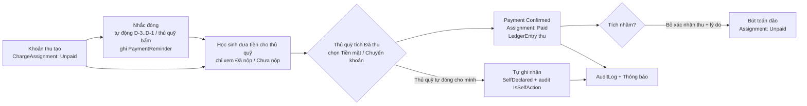
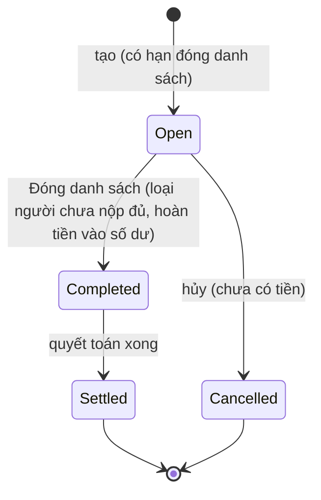

# Quy tắc nghiệp vụ & quy trình

> Mã `BR-xx` được trích trong code (comment), test (tên test) và module plan. Quy tắc đã có hàm dùng chung ở Domain ghi rõ ở cột "Cài đặt".

## 1. Quy tắc nghiệp vụ

### 1.1. Phạm vi tài chính

| Mã | Quy tắc | Cài đặt |
|---|---|---|
| BR-01 | Mỗi khoản thu, giao dịch, thông báo, dòng audit thuộc đúng **một** phạm vi: Quỹ chung (`EventId = null`) hoặc một Sự kiện (`EventId` có giá trị). | Cột `EventId` nullable – không thể "vừa chung vừa sự kiện". `FinancialScope` cho Notification/AuditLog. |
| BR-02 | Số liệu quỹ chung **không** gồm giao dịch sự kiện và ngược lại. Mọi truy vấn báo cáo phải lọc theo `EventId`. | Module M13 |
| BR-03 | Không lấy quỹ chung bù thiếu sự kiện, không chuyển tiền thừa sự kiện vào quỹ chung. Không có API chuyển tiền giữa hai phạm vi. | – |
| BR-04 | Quỹ chung không quyết toán theo hoạt động; cần thêm tiền thì tạo khoản thu chung mới; số dư giữ tới tổng kết cuối năm. **Khoản thu chung không có hạn đóng** (`Charge.DueDate = null`): thủ quỹ nhắc đóng đến khi mọi người đã nộp, rồi tổng kết cuối năm chia đều theo đầu người (BR-36). | M6, M13 |

### 1.2. Tiền & chứng từ

| Mã | Quy tắc | Cài đặt |
|---|---|---|
| BR-05 | Tiền là số nguyên VND > 0 (tối đa 100 tỷ). | `MoneyRule`, CHECK trong DB |
| BR-06 | Giao dịch **> 500.000đ** bắt buộc chứng từ; ≤ 500.000đ tùy chọn. | `EvidenceRule.EnsureProvided` |
| BR-07 | File lưu trên Neon Object Storage, giới hạn theo loại: hóa đơn & bill chuyển khoản (ảnh/PDF ≤ 5 MB), ảnh đại diện (ảnh ≤ 2 MB), tài liệu (PDF/Word/Excel/ảnh ≤ 10 MB). Khóa lưu ngẫu nhiên `{kind}/{fundId}/{guid}.ext`, không dùng tên file gốc làm đường dẫn; tải file qua API có kiểm quyền. | `FileRule`, `StorageKeys`, `IFileStorage` |
| BR-08 | Sổ thu chi chỉ ghi thêm. Sửa sai = bút toán đảo (`ReversesEntryId`) + lý do; một dòng chỉ bị đảo một lần. | Trigger append-only (migration), M7 |
| BR-09 | Ngày giao dịch không ở tương lai (theo giờ VN). | `VietnamTime`, M7 |
| BR-38 | **Chi ≤ thu** (OQ-18): ghi chi bị từ chối nếu làm tổng chi của phạm vi (quỹ chung hoặc sự kiện) vượt tổng thu đã ghi sổ, tức số tiền chi ≤ số dư hiện có của phạm vi. Kiểm tra trong cùng transaction, khóa theo phạm vi để tránh ghi song song. | `SpendingRule.EnsureWithinBalance`, M7 |
| BR-39 | Ghi **thu** không nhập tay: thủ quỹ tạo khoản thu (FR-18 / FR-19); `LedgerEntry` thu chỉ sinh khi thủ quỹ tích "đã thu" (BR-10, BR-12). | M6, M7 |

### 1.3. Thanh toán (thủ quỹ tích "đã thu")

> Thay đổi theo góp ý mentor (2026-11-23): **bỏ** luồng học sinh bấm "Tôi đã nộp" → thủ quỹ duyệt. Học sinh chỉ **xem** Đã nộp / Chưa nộp; thủ quỹ là người ghi nhận. BR-10, BR-11, BR-14, BR-15 viết lại; không còn `Submitted`, `Rejected`, `AwaitingConfirmation` cho dữ liệu mới.

| Mã | Quy tắc | Cài đặt |
|---|---|---|
| BR-10 | Thủ quỹ tích **"đã thu"** cho từng người của từng khoản thu (chung hoặc sự kiện) và chọn **đúng một trong hai** hình thức: **Tiền mặt** hoặc **Chuyển khoản** (mã giao dịch tùy chọn). **Số dư cá nhân không phải phương thức thanh toán.** Tích "đã thu" ⇒ `Payment` Confirmed + nghĩa vụ `Paid` + `LedgerEntry` thu (đúng phạm vi) + thông báo + audit `payment.collect`, cùng một transaction. Học sinh không có thao tác nộp/duyệt. | `PaymentsService.CollectAsync`, `POST /assignments/{id}/collect` |
| BR-11 | Ảnh minh chứng chuyển khoản **không bắt buộc** (thủ quỹ đã đối chiếu tiền); nếu có thì do thủ quỹ tải (`PaymentProof` cần `Payment.Confirm`). | `AttachmentsService` |
| BR-12 | Thủ quỹ tự đóng cho mình: thủ quỹ tự tích "đã thu" cho chính mình, `ConfirmationMode = SelfDeclared`, `LedgerEntry.IsSelfDeclared = true`, audit `IsSelfAction = true` (đánh dấu **"Tự ghi nhận"**). | `PaymentConfirmationPolicy` |
| BR-13 | Báo cáo tách riêng thu tự ghi nhận của thủ quỹ (OQ-01). Thủ quỹ chịu trách nhiệm bù nếu khai sai. | M13 |
| BR-14 | Mỗi nghĩa vụ chỉ có một lần ghi nhận đang hiệu lực. Tích nhầm → **"Bỏ xác nhận thu"** (bắt buộc lý do): ghi bút toán **đảo** vào sổ, `Payment` hủy, nghĩa vụ về `Unpaid`, audit `payment.uncollect`; sau đó tích lại được. Khoản thu đã đóng thì không tích / bỏ tích. | `UX_Payment_OneActivePerAssignment`, `UncollectAsync` |
| BR-15 | **Nhắc đóng:** (a) tự động **D-3…D-1** trước hạn (khoản thu sự kiện: trước hạn đóng danh sách; số ngày cấu hình `Reminders:ListDeadlineDays`, mặc định 3), mỗi người tối đa một lần/ngày; (b) thủ quỹ bấm **"Nhắc đóng"** từng người (tối thiểu 1 giờ giữa hai lần) hoặc cả khoản thu. **Mọi lần nhắc đều ghi `PaymentReminder`** (loại Auto/Manual, người nhắc, thời điểm) + thông báo + audit. Khoản thu chung không hạn thì chỉ có nhắc tay. | `NotificationsService`, `PaymentReminder` |
| BR-15b | Dữ liệu cũ: migration `MentorFeedbackFlowSchema` đổi thanh toán `Submitted` → `Rejected` (kèm thông báo cho người nộp: hãy đưa tiền cho thủ quỹ), nghĩa vụ `AwaitingConfirmation` → `Unpaid`; yêu cầu rút `Requested` → `Rejected` (kèm thông báo). | Migration |

### 1.4. Sự kiện & quyết toán

| Mã | Quy tắc | Cài đặt |
|---|---|---|
| BR-16 | Vòng đời: `Open → Completed ("Đóng danh sách") → Settled`; `Open → Cancelled` (chỉ khi chưa có tiền thu/chi). Sự kiện có **hạn đóng danh sách** (`ListDeadline`, bắt buộc, không ở quá khứ khi tạo/sửa). Không quay lui. | `EventStatusRules` |
| BR-17 | Tạo sự kiện ⇒ mời mọi thành viên Active (EventParticipant `Pending`). Thành viên thêm sau được mời khi sự kiện còn `Open`. Đổi trả lời được khi còn `Open`. | M8 |
| BR-18 | Khoản thu sự kiện chỉ tạo khi `Open`, áp cho người `Accepted`, **cùng một mức cho mọi người** (một số tiền/người mỗi khoản). Màn quản lý chỉ liệt kê người `Accepted`. | M6, M8 |
| BR-19 | **Đóng danh sách** (`Open → Completed`): thủ quỹ đóng khi tới hạn (đóng sớm hơn hạn phải `confirmEarly`, 422 `event.list_deadline_not_reached`). Người `Accepted` **chưa nộp đủ TẤT CẢ khoản thu đang mở** (kể cả đã nộp một phần) bị **loại** (`IsFinal = false`, `ExclusionReason`, `ExcludedAt`, `RefundedAmount`), nghĩa vụ → `Excluded`, **số tiền đã nộp được hoàn vào số dư cá nhân** (`BalanceTransaction(ListCloseRefund)` + bút toán chi `Source=Refund` trong sổ sự kiện), có thông báo. Không có khoản thu đang mở ⇒ không ai bị loại. Lịch sử (ai, lý do, số tiền hoàn, thời điểm) hiển thị ở nhật ký (`event.close_list`, `event.exclude`) và mục "Lịch sử đóng danh sách" của trang sự kiện. | `EventsService.CloseListAsync` |
| BR-20 | Chi cho sự kiện **chỉ sau khi đóng danh sách** (`Completed`) và trước khi quyết toán (`event.list_not_closed` khi còn `Open`). Từ `Completed`: không tạo khoản thu mới, không còn tích "đã thu" thêm (danh sách đã chốt, nghĩa vụ của người còn lại đã đủ). Sau `Settled` / `Cancelled`: sổ khóa. | `EventStatusRules.AcceptsExpenses` |
| BR-21 | Quyết toán chỉ khi `Completed`; tính trên người `IsFinal`; tổng thu = thu của sự kiện (gồm tự ghi nhận, đã trừ phần hoàn khi đóng danh sách), tổng chi = chi của sự kiện (trừ bút toán đảo). Do BR-38, tổng thu ≥ tổng chi nên chỉ có tiền thừa (hoặc vừa đủ). | M9 |
| BR-22 | Tiền thừa chia **đều theo đầu người** cho người `IsFinal` (thay cho chia theo tỷ lệ đã đóng); mỗi phần **làm tròn xuống bội 1.000đ**, phần lẻ < 1.000đ không chia (`SettlementCalculator.AllocateEqually`). Hoàn trực tiếp → `LedgerEntry` chi `Source=Refund` khi thủ quỹ xác nhận từng người. Cộng số dư → `BalanceTransaction(SettlementCredit)` ngay. | M9 + M10 |
| BR-23 | Không có khoản thu bổ sung. Sau đóng danh sách mọi người còn lại đã nộp đủ; nếu vẫn còn nghĩa vụ `Unpaid` (dữ liệu bất thường) thì **chặn** quyết toán (`unpaidObligationCount > 0`). | M9 |
| BR-24 | Mỗi sự kiện quyết toán một lần (unique `Settlement.EventId`). | DB |

### 1.4b. Quyết toán cuối năm quỹ chung (OQ-13)

| Mã | Quy tắc | Cài đặt |
|---|---|---|
| BR-34 | Quyết toán quỹ chung làm **một lần duy nhất** mỗi quỹ (`Settlement` có `EventId = null`, unique theo quỹ). | `UX_Settlement_OneYearEndPerFund` |
| BR-35 | Điều kiện: quỹ `Active`, mọi sự kiện đã `Settled` hoặc `Cancelled`, **và mọi thành viên đã nộp đủ mọi khoản thu chung** (thủ quỹ nhắc đóng cho đủ; còn nghĩa vụ `Unpaid` ⇒ 422 `year_end.unpaid_obligations`). | `YearEndRule.EnsureCanClose` |
| BR-36 | Người được chia: mọi thành viên `Active` của quỹ (cả lớp, gồm thủ quỹ). Tổng thu/chi chỉ tính giao dịch quỹ chung. Thừa → hoàn trực tiếp / cộng số dư, **chia đều theo đầu người** (vì mọi người đã đóng đủ; làm tròn xuống bội 1.000đ như BR-22). Cách tính dùng chung `SettlementCalculator.AllocateEqually` với quyết toán sự kiện. | M14 |
| BR-37 | Xong quyết toán → quỹ `Archived`: không nhận khoản thu, giao dịch, sự kiện, thành viên mới (trừ xác nhận hoàn tiền); vẫn xem báo cáo, **thủ quỹ vẫn rút số dư giúp học sinh (BR-26)**. | `YearEndRule.EnsureFundActive` |

### 1.5. Số dư cá nhân

| Mã | Quy tắc | Cài đặt |
|---|---|---|
| BR-25 | Số dư theo (quỹ, người), không âm, độc lập quỹ chung; mọi thay đổi có `BalanceTransaction` (append-only) ghi `BalanceAfter`. Số dư **chỉ được cộng** từ (a) tiền thừa quyết toán (sự kiện / cuối năm) và (b) tiền hoàn khi bị loại lúc đóng danh sách (BR-19); **chỉ bị trừ** khi thủ quỹ rút (BR-26). Không còn dùng số dư để đóng khoản thu. | CHECK + xmin concurrency |
| BR-26 | **Rút số dư do thủ quỹ thực hiện** (thay cho "học sinh yêu cầu rút toàn bộ"): học sinh chỉ xem số dư. Màn "Rút số dư" liệt kê mọi học sinh kèm số dư; thủ quỹ bấm "Rút tiền" và nhập số tiền: **≥ 10.000đ, là bội của 1.000đ, ≤ số dư**. Kiểm ở FE, ở BE (FluentValidation 400) và lại **dưới khóa dòng** (422 `balance.insufficient`). Trừ số dư + `BalanceTransaction(Withdrawal)` + bản ghi lịch sử rút + audit `balance.withdraw`; **không** ghi `LedgerEntry`. Thủ quỹ rút số dư của chính mình được, đánh dấu tự ghi nhận. | `WithdrawalRule`, `WithdrawalsService`, M10 |

> Ghi chú BR-26: số dư cá nhân là tiền thủ quỹ **giữ hộ**, không thuộc quỹ chung cũng không thuộc sự kiện. Báo cáo có mục riêng "Tiền giữ hộ = tổng số dư cá nhân".

### 1.6. Tài khoản & thành viên

| Mã | Quy tắc | Cài đặt |
|---|---|---|
| BR-27 | Email là định danh, chuẩn hóa chữ thường, duy nhất toàn hệ thống. | `EmailAddress`, `UX_User_Email` |
| BR-28 | Mật khẩu 8–128 ký tự, có chữ và số. Mật khẩu tạm 16 ký tự ngẫu nhiên, hiển thị một lần. | `PasswordPolicy`, `Credentials.TemporaryPassword` |
| BR-29 | Đổi mật khẩu / cấp lại mật khẩu tạm / khóa tài khoản ⇒ đổi `SecurityStamp` ⇒ các phiên cũ mất hiệu lực. | `IdentityStore` |
| BR-30 | Ngừng thành viên không xóa dữ liệu lịch sử; thành viên `Removed` mất quyền truy cập quỹ. | `AccessService` |

### 1.7. Thông báo & audit

| Mã | Quy tắc | Cài đặt |
|---|---|---|
| BR-31 | Thông báo tạo cùng transaction với nghiệp vụ; tiêu đề có tiền tố `[Quỹ chung]` / `[Sự kiện: tên]`. | `Notifier` |
| BR-32 | Thông báo khoản thu sự kiện chỉ gửi người tham gia (người có nghĩa vụ). | M6 |
| BR-33 | Mọi thao tác ghi (trừ đọc) ghi `AuditLog` cùng transaction: actor, phạm vi, sự kiện, entity, before/after (JSON), `IsSelfAction`, lý do. Không ghi mật khẩu, hash, token. | `AuditTrail` |

## 2. Quy trình

### 2.1. Thu tiền khoản thu (BR-10 → BR-15)

### 2.2. Vòng đời sự kiện

Trong `Open`: học sinh trả lời tham gia; thủ quỹ tạo khoản thu (cùng mức cho mọi người), tích "đã thu", nhắc đóng; **chưa ghi chi**.
Khi **đóng danh sách** (BR-19): loại người chưa nộp đủ tất cả khoản thu, hoàn tiền đã nộp vào số dư cá nhân, ghi lịch sử.
Trong `Completed`: ghi chi (chi ≤ số dư sự kiện, BR-38); không tạo khoản thu mới.

### 2.3. Quyết toán sự kiện

1. Sự kiện `Completed` → thủ quỹ mở màn hình quyết toán, hệ thống tính: số người tham gia (`IsFinal`), tổng thu, tổng chi, tiền thừa (≥ 0 do BR-38).
2. **Vừa đủ** (thừa = 0) → xác nhận → `Settled`.
3. **Thừa** → chọn phương án (hoàn trực tiếp / cộng số dư); phần mỗi người **chia đều theo đầu người**, làm tròn xuống 1.000đ (BR-22) → xem trước → xác nhận:
   - Cộng số dư: cộng ngay, thông báo `BalanceCredited`.
   - Hoàn trực tiếp: `SettlementLine` chờ hoàn; thủ quỹ xác nhận từng người đã nhận tiền (ghi chi `Refund`).
4. Ghi `Settlement` (EventId = sự kiện), audit, thông báo `SettlementResult` cho người tham gia → sự kiện `Settled`.

### 2.4. Rút số dư (thủ quỹ thực hiện)

1. Thủ quỹ trả tiền mặt / chuyển khoản cho học sinh ngoài hệ thống, rồi mở **"Rút số dư"**: danh sách mọi học sinh kèm số dư.
2. Bấm **"Rút tiền"**, nhập đúng số tiền đã trả (≥ 10.000đ, bội của 1.000đ, ≤ số dư) – FE và BE cùng kiểm.
3. Hệ thống trừ số dư dưới khóa dòng, ghi `BalanceTransaction(Withdrawal)`, lịch sử rút và audit `balance.withdraw`; học sinh thấy biến động trong "Số dư cá nhân".

Học sinh chỉ xem số dư. Thủ quỹ rút số dư của chính mình: audit `IsSelfAction = true`.

### 2.6. Quyết toán cuối năm quỹ chung

1. Mọi sự kiện đã quyết toán / hủy → thủ quỹ mở "Tổng kết cuối năm": hệ thống tổng hợp tổng thu, tổng chi, số dư quỹ chung, khoản chưa hoàn thành, số thành viên.
2. Chỉ thực hiện được khi **mọi thành viên đã nộp đủ mọi khoản thu chung** (thủ quỹ nhắc đóng đến khi đủ). Chọn phương án như quyết toán sự kiện (mục 2.3) – người được chia là **cả lớp**, **chia đều theo đầu người** (BR-36).
3. Xác nhận → `Settlement` (EventId null), thông báo `SettlementResult` cho cả lớp (phạm vi Quỹ chung), quỹ chuyển `Archived`.

### 2.5. Thêm học sinh

Thủ quỹ nhập email (+ họ tên) → email mới: tạo User `Provisioned` + mật khẩu tạm (hiện một lần) → FundMember `Student` → học sinh đăng nhập, bắt buộc đổi mật khẩu. Email đã có tài khoản: chỉ thêm FundMember (không cấp mật khẩu).
