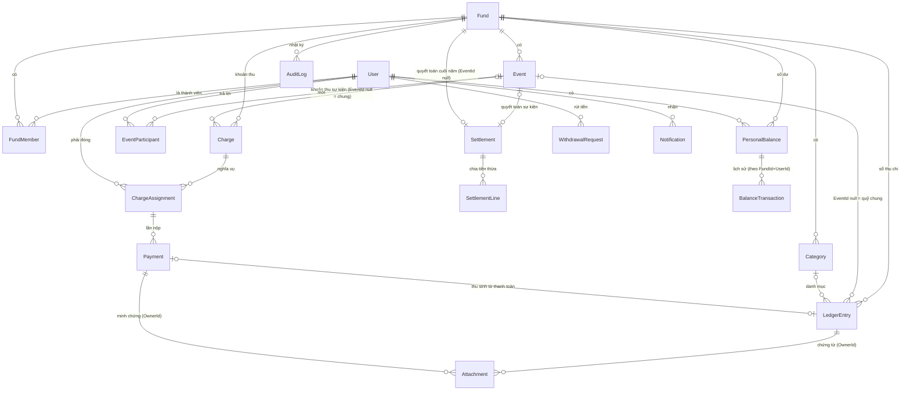

# Thiết kế cơ sở dữ liệu

> Code: `ClassFund.Domain/Entities/*.cs` + `ClassFund.Infrastructure/Persistence/Configurations/*.cs`.
> Migration: `ClassFund.Infrastructure/Persistence/Migrations/20261117020201_InitialSchema.cs` (M0-02, 2026-11-17). **Chưa áp lên Neon** – việc của M0-03 theo quy trình `docs/implementation/neon-database-guide.md`.

## 1. Quy ước

| Hạng mục | Quy ước |
|---|---|
| Tên bảng / cột | PascalCase, bảng số ít (`"FundMember"`), giữ nguyên trong SQL bằng dấu nháy kép |
| Khóa chính | `uuid` (UUID v7 sinh ở ứng dụng, `Entity.Id`) |
| Tiền | `bigint` (VND, số nguyên) + CHECK `> 0` / `>= 0` |
| Enum | `varchar(32)` lưu tên enum (`'Owner'`, `'Confirmed'`) – đọc được khi đối chiếu |
| Chuỗi | Mặc định `varchar(500)`; cột có độ dài riêng khai báo trong Configuration |
| Thời điểm | `timestamptz` (UTC) – `DateTimeOffset` |
| Ngày nghiệp vụ | `date` – `DateOnly`, theo giờ Việt Nam |
| FK | `ON DELETE RESTRICT` – không xóa dây chuyền; dữ liệu nghiệp vụ không xóa cứng |
| Navigation | Không dùng navigation property; truy vấn bằng join qua `IAppDb.Query<T>()` |
| Đồng thời | `PersonalBalance` dùng `xmin` làm concurrency token; thao tác cần tuần tự dùng `IAppDb.LockAsync` (`SELECT … FOR UPDATE`) |

## 2. ERD

## 3. Bảng

### 3.1. Tài khoản & quỹ

| Bảng | Cột chính | Ràng buộc / index |
|---|---|---|
| `User` | Email, FullName, PasswordHash, Origin (`SelfRegistered`/`Provisioned`), MustChangePassword, IsActive, SecurityStamp, AvatarAttachmentId?, CreatedAt | `UX_User_Email` (unique) |
| `Fund` | Name, CreatedByUserId, SchoolYear, Status (`Active`/`Archived`), CreatedAt | FK User |
| `FundMember` | FundId, UserId, Role (`Owner`/`Treasurer`/`Student`), Status (`Active`/`Removed`), JoinedAt, RemovedAt | `UX_FundMember_Fund_User`; `UX_FundMember_OneOwnerPerFund` (unique partial: Role='Owner' AND Status='Active') |
| `Category` | FundId, Name, Type (`Income`/`Expense`), IsSystem, IsActive | `UX_Category_Fund_Type_Name` |

### 3.2. Sự kiện & khoản thu

| Bảng | Cột chính | Ràng buộc / index |
|---|---|---|
| `Event` | FundId, Name, Description, EventDate, Status, ListLockedAt, CreatedByUserId, CreatedAt | `IX_Event_Fund_Status` |
| `EventParticipant` | EventId, UserId, Response (`Pending`/`Accepted`/`Declined`), RespondedAt, IsFinal, ExclusionReason | `UX_EventParticipant_Event_User` |
| `Charge` | FundId, **EventId?**, Title, Purpose, AmountPerPerson, DueDate, Kind (`Regular`/`Supplementary`), Status (`Open`/`Closed`/`Cancelled`), CreatedByUserId, CreatedAt | CHECK AmountPerPerson > 0; `IX_Charge_Fund_Event_Status` |
| `ChargeAssignment` | ChargeId, UserId, AmountDue, Status (`Unpaid`/`AwaitingConfirmation`/`Paid`/`Excluded`/`Cancelled`) | `UX_ChargeAssignment_Charge_User`; CHECK AmountDue ≥ 0 |
| `Payment` | AssignmentId, PayerUserId, Amount, Method (`Cash`/`BankTransfer`/`PersonalBalance`), TransferCode, Status (`Submitted`/`Confirmed`/`Rejected`), SubmittedAt, ConfirmedByUserId, ConfirmedAt, ConfirmationMode (`Verified`/`SelfDeclared`), RejectionReason | `UX_Payment_OneActivePerAssignment` (unique partial: Status <> 'Rejected'); CHECK Amount > 0 |

### 3.3. Sổ thu chi & chứng từ

| Bảng | Cột chính | Ràng buộc / index |
|---|---|---|
| `LedgerEntry` | FundId, **EventId?**, Type (`Income`/`Expense`), Source (`Manual`/`Payment`/`Refund`/`BalanceWithdrawal`), CategoryId?, Title, Purpose, Amount, TransactionDate, PerformedByUserId, PaymentId?, TransferCode, Note, IsSelfDeclared, ReversesEntryId?, CreatedAt | CHECK Amount > 0; `IX_LedgerEntry_Fund_Event_Date`; `UX_LedgerEntry_PaymentId` (partial). **Append-only** |
| `Attachment` | FundId? (null chỉ với Avatar), Kind (`Receipt`/`PaymentProof`/`Avatar`/`Document`), OwnerId? (null = chưa gắn), FileName, ContentType, SizeBytes, **StorageKey** (khóa object trên Neon Object Storage), UploadedByUserId, UploadedAt | `IX_Attachment_OwnerId`; `UX_Attachment_StorageKey`; CHECK FundId NOT NULL OR Kind = 'Avatar'. Nội dung file KHÔNG lưu trong DB |

Bút toán đảo: dòng mới cùng phạm vi, Type ngược lại, `ReversesEntryId` = dòng gốc. Số dư phạm vi = Σ Income − Σ Expense.

### 3.4. Quyết toán & số dư cá nhân

| Bảng | Cột chính | Ràng buộc / index |
|---|---|---|
| `Settlement` | FundId, **EventId?** (null = quyết toán cuối năm quỹ chung), ParticipantCount, TotalCollected, TotalSpent, Outcome, SurplusMethod?, AllocationRule?, SupplementaryChargeId?, SettledByUserId, SettledAt | `UX_Settlement_EventId` (partial, EventId NOT NULL); `UX_Settlement_OneYearEndPerFund` (partial, EventId NULL) – mỗi phạm vi quyết toán đúng một lần |
| `SettlementLine` | SettlementId, UserId, Contributed, RefundAmount, Status (`PendingRefund`/`Refunded`/`CreditedToBalance`), ConfirmedByUserId, ConfirmedAt | `UX_SettlementLine_Settlement_User`; CHECK RefundAmount ≥ 0 |
| `PersonalBalance` | FundId, UserId, Balance, `xmin` | `UX_PersonalBalance_Fund_User`; CHECK Balance ≥ 0 |
| `BalanceTransaction` | FundId, UserId, Type (`SettlementCredit`/`ChargePayment`/`Withdrawal`/`Adjustment`), Amount (có dấu), BalanceAfter, ReferenceId, CreatedByUserId, CreatedAt | CHECK BalanceAfter ≥ 0. **Append-only** |
| `WithdrawalRequest` | FundId, UserId, Amount, Status (`Requested`/`Paid`/`Rejected`), RequestedAt, HandledByUserId, HandledAt, RejectionReason. Amount = toàn bộ số dư lúc yêu cầu (OQ-11) | `IX_WithdrawalRequest_Fund_Status`; `UX_WithdrawalRequest_OnePendingPerUser` (partial: Status = 'Requested') |

### 3.5. Thông báo & nhật ký

| Bảng | Cột chính | Ràng buộc / index |
|---|---|---|
| `Notification` | UserId, FundId, Scope (`General`/`Event`/`System`), EventId?, Type, Title, Body, ReferenceType, ReferenceId, IsRead, CreatedAt | `IX_Notification_User_Read_At` |
| `AuditLog` | At, FundId?, ActorUserId?, Scope, EventId?, Action, EntityType, EntityId, BeforeJson (`jsonb`), AfterJson (`jsonb`), IsSelfAction, Note, CorrelationId, IpAddress (`inet`) | `IX_AuditLog_Fund_At`, `IX_AuditLog_Fund_Scope_Event`. **Append-only** |

## 4. Ràng buộc bổ sung trong migration `InitialSchema` (M0-02 – đã làm)

Mục 2, 3 khai báo trong Configuration (có trong model snapshot); riêng trigger viết tay bằng `migrationBuilder.Sql(...)`. Kiểm bởi `tests/ClassFund.IntegrationTests/Foundation/InitialSchemaTests.cs`.

1. **Trigger append-only** (`fn_append_only`, `TR_<Bảng>_AppendOnly`, `TR_<Bảng>_NoTruncate`) cho `AuditLog`, `LedgerEntry`, `BalanceTransaction`: chặn UPDATE, DELETE, TRUNCATE, lỗi `restrict_violation` (23001).
2. **CHECK phạm vi** `CK_AuditLog_Scope`, `CK_Notification_Scope`: `("Scope" = 'Event') = ("EventId" IS NOT NULL)`.
3. **Bút toán đảo**: `CK_LedgerEntry_NotSelfReversal`, FK tự tham chiếu `ReversesEntryId`, unique partial `UX_LedgerEntry_ReversesEntryId` (một dòng chỉ bị đảo một lần).
4. Quyền: bảng do `migrator_user` sở hữu; `app_user` chỉ `SELECT, INSERT, UPDATE` (default privileges trong `ClassFundAPI/database/neon-roles.sql`).

## 5. Seed

`DatabaseSeeder` (Infrastructure/Persistence/Seeding) – chạy tay `dotnet run --project src/ClassFund.Api -- --seed` (chỉ Development):

- 1 thủ quỹ demo `thuquy.demo@classfund.local`, 3 học sinh demo `hocsinhN.demo@classfund.local`, mật khẩu `Demo1234` (dữ liệu giả).
- Quỹ "Lớp 10A1 (demo)" + danh mục mặc định (`DefaultCategories`).
- Idempotent: khóa theo email / tên quỹ; chạy lại không tạo trùng, không xóa gì.
- Danh mục mặc định cho quỹ thật được tạo bởi M2 khi tạo quỹ (cùng danh sách `DefaultCategories`).
