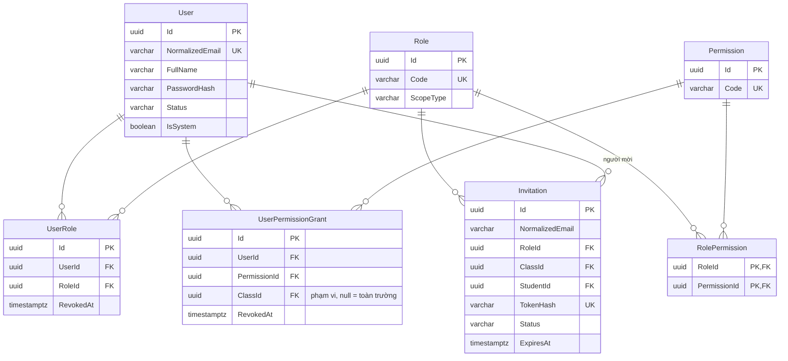
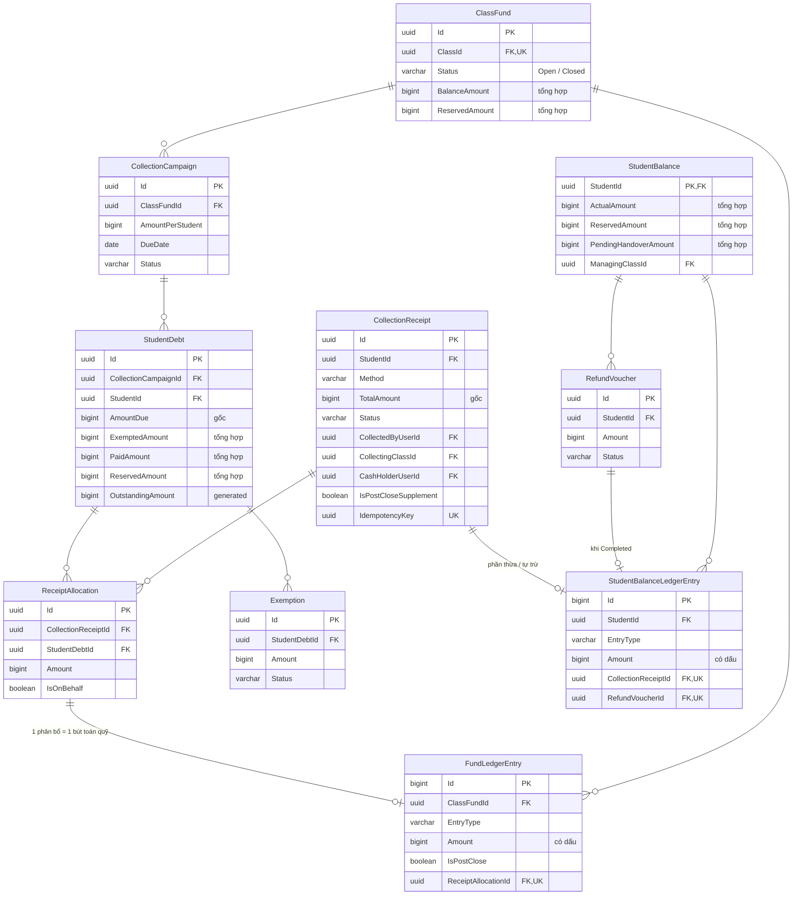
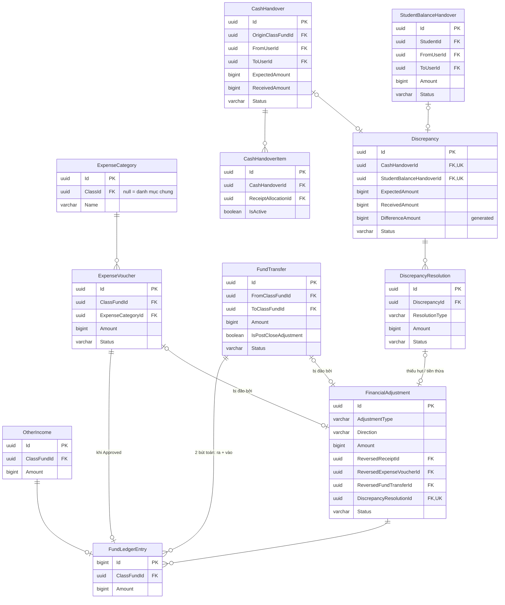
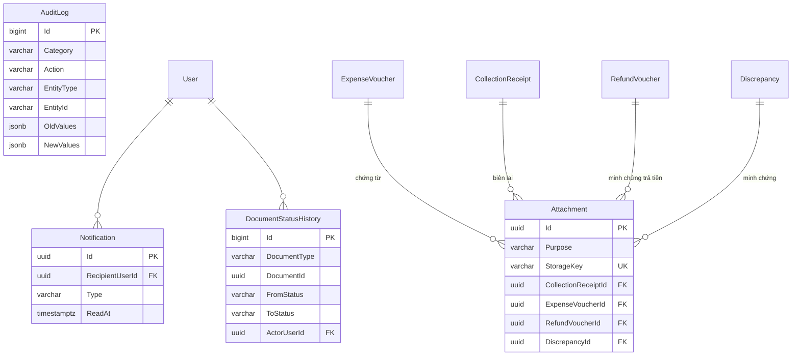

# ERD – School Fund Management

> Phiên bản: 0.1 (bản nháp, chờ duyệt) · Ngày: 2026-11-03
> Chi tiết cột: [data-dictionary.md](data-dictionary.md). Ký hiệu Mermaid: `||--o{` một – nhiều (0..n), `||--||` một – một, `|o--o{` không bắt buộc – nhiều.

## 1. ERD tổng thể (quan hệ chính)

```mermaid
erDiagram
    SchoolYear ||--o{ Class : "có"
    Class ||--|| ClassFund : "có một quỹ"
    Class ||--o{ ClassAssignment : "GVCN / Thủ quỹ / Người giữ quỹ"
    User ||--o{ ClassAssignment : "được phân công"
    Role ||--o{ ClassAssignment : "vai trò"
    User ||--o{ UserRole : ""
    Role ||--o{ UserRole : ""
    Role ||--o{ RolePermission : ""
    Permission ||--o{ RolePermission : ""
    User ||--o{ UserPermissionGrant : "cấp riêng"
    Permission ||--o{ UserPermissionGrant : ""

    Student ||--o{ StudentClassEnrollment : "lịch sử lớp"
    Class ||--o{ StudentClassEnrollment : ""
    User ||--o{ ParentStudent : "phụ huynh"
    Student ||--o{ ParentStudent : ""
    Student ||--|| StudentBalance : "số dư cá nhân"

    ClassFund ||--o{ CollectionCampaign : "đợt thu"
    CollectionCampaign ||--o{ StudentDebt : "khoản nợ"
    Student ||--o{ StudentDebt : ""
    Student ||--o{ CollectionReceipt : "phiếu thu"
    CollectionReceipt ||--o{ ReceiptAllocation : "phân bổ"
    StudentDebt ||--o{ ReceiptAllocation : "được thanh toán bởi"
    StudentDebt ||--o{ Exemption : "miễn giảm"

    ClassFund ||--o{ OtherIncome : ""
    ClassFund ||--o{ ExpenseVoucher : ""
    ExpenseCategory ||--o{ ExpenseVoucher : ""
    Student ||--o{ RefundVoucher : ""

    ClassFund ||--o{ FundTransfer : "chuyển đi"
    ClassFund ||--o{ FundTransfer : "nhận"
    ClassFund ||--o{ CashHandover : "lớp gốc"
    CashHandover ||--o{ CashHandoverItem : ""
    ReceiptAllocation ||--o{ CashHandoverItem : "tiền thu hộ"
    Student ||--o{ StudentBalanceHandover : ""
    CashHandover |o--o| Discrepancy : ""
    StudentBalanceHandover |o--o| Discrepancy : ""
    Discrepancy ||--o{ DiscrepancyResolution : "phương án"
    DiscrepancyResolution |o--o| FinancialAdjustment : "điều chỉnh"

    ClassFund ||--o{ FundLedgerEntry : "sổ cái quỹ"
    Student ||--o{ StudentBalanceLedgerEntry : "sổ số dư cá nhân"
```

Ba "trục" của dữ liệu tài chính:
- **Trục quỹ lớp:** `ClassFund` ← `CollectionCampaign` ← `StudentDebt` ← `ReceiptAllocation` → `FundLedgerEntry`.
- **Trục học sinh:** `Student` → `StudentBalance` → `StudentBalanceLedgerEntry`.
- **Trục người giữ tiền:** `CollectionReceipt.CashHolderUserId` → `CashHandoverItem` / `CashHandover`.

## 2. Identity & Authorization



Quyền hiệu lực của một người trong một lớp = permission của (vai trò trong `UserRole`) ∪ (vai trò trong `ClassAssignment` hiệu lực của lớp đó) ∪ (`UserPermissionGrant` hiệu lực, phạm vi lớp đó hoặc toàn trường). Phụ huynh: phạm vi là các học sinh trong `ParentStudent` hiệu lực.

## 3. Academic – năm học, lớp, học sinh, lịch sử chuyển lớp

```mermaid
erDiagram
    SchoolYear {
        uuid Id PK
        varchar Code UK
        date StartDate
        date EndDate
        varchar Status
    }
    Class {
        uuid Id PK
        uuid SchoolYearId FK
        varchar Name "UK cùng SchoolYearId"
    }
    ClassAssignment {
        uuid Id PK
        uuid ClassId FK
        uuid UserId FK
        uuid RoleId FK
        timestamptz StartedAt
        timestamptz EndedAt "null = hiệu lực"
    }
    Student {
        uuid Id PK
        varchar StudentCode UK
        varchar FullName
        varchar Status
    }
    StudentClassEnrollment {
        uuid Id PK
        uuid StudentId FK
        uuid ClassId FK
        date StartedOn
        date EndedOn "null = đang học"
        varchar EndReason
    }
    ParentStudent {
        uuid Id PK
        uuid ParentUserId FK
        uuid StudentId FK
        timestamptz UnlinkedAt
    }
    SchoolYear ||--o{ Class : ""
    Class ||--o{ ClassAssignment : ""
    Class ||--o{ StudentClassEnrollment : ""
    Student ||--o{ StudentClassEnrollment : ""
    Student ||--o{ ParentStudent : ""
```

Ví dụ lịch sử: An học 6A (2026-2027) rồi lên 7A (2027-2028):

| StudentClassEnrollment | ClassId | StartedOn | EndedOn | EndReason |
|---|---|---|---|---|
| #1 | 6A / 2026-2027 | 2026-09-05 | 2027-05-31 | `Promoted` |
| #2 | 7A / 2027-2028 | 2027-09-05 | null | |

Khoản nợ của An ở 6A vẫn trỏ về `CollectionCampaign` của quỹ 6A / 2026-2027; không có bản sao ở 7A.

## 4. Thu & khoản nợ & số dư cá nhân



**Liên hệ thu – nợ – số dư cá nhân – quỹ lớp:** một `CollectionReceipt` (600.000 đ) có `ReceiptAllocation` 500.000 đ vào `StudentDebt` của đợt thu quỹ 6A → sinh `FundLedgerEntry` +500.000 ở **quỹ 6A** (quỹ của đợt thu, không phải quỹ của lớp người thu). Phần còn lại 100.000 đ → `StudentBalanceLedgerEntry` +100.000 của học sinh, **không** vào quỹ nào.

## 5. Chi, chuyển quỹ, bàn giao, chênh lệch, điều chỉnh



**Chứng từ gốc ↔ chứng từ điều chỉnh / đảo giao dịch:** `FinancialAdjustment` có một FK tường minh tới chứng từ gốc (`Reversed*Id`) hoặc tới phương án chênh lệch (`DiscrepancyResolutionId`). Chứng từ gốc **không** bị sửa; trạng thái "đã bị đảo" được suy ra từ việc tồn tại `FinancialAdjustment` `Approved` trỏ tới nó. Mỗi chứng từ gốc có tối đa một đảo giao dịch hiệu lực (partial unique).

**Bàn giao không phải khoản thu:** `CashHandover`, `StudentBalanceHandover` **không** có quan hệ tới `FundLedgerEntry` / `StudentBalanceLedgerEntry`. Chỉ phương án `ShortageWriteOff` / `SurplusRecognition` đã duyệt (qua `FinancialAdjustment`) mới làm thay đổi số dư.

## 6. Supporting & Audit



`Attachment` có 10 FK chủ sở hữu (chỉ vẽ 4 cho gọn); đúng một FK có giá trị.
