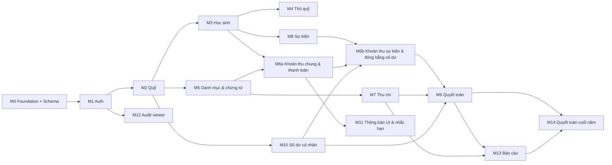

# Kế hoạch module & phân chia task

> Mỗi module làm **trọn luồng FE → BE → DB → Test** theo `docs/architecture/foundation-guide.md`, tuân thủ `coding-standards.md`.
> Giao task cho Claude Code: *"Làm task `M6-T2` theo docs/implementation/module-plan.md"*. Một task = một nhánh `feature/<mã>-<tên>` = một PR.
> Dev A / Dev B là đề xuất – nhóm đổi tùy ý, ghi lại ở `implementation-status.md`.

## 1. Tổng quan & phụ thuộc

| Giai đoạn | Dev A | Dev B | Điều kiện bắt đầu |
|---|---|---|---|
| 0 | ~~M0-01~~ (đã duyệt 2026-11-17) · M0-02 migration InitialSchema | M0-03 Neon roles + áp migration + seed · M5-T0 adapter Neon Object Storage | – |
| 1 | M1 Auth & tài khoản | M2 Quỹ | M0 xong |
| 2 | M3 Học sinh → M4 Thủ quỹ | M5 Danh mục & chứng từ → M12 Audit viewer | M1 (API `/auth/me`) |
| 3 | M6a Khoản thu chung & thanh toán | M7 Thu chi · M8 Sự kiện | M3, M5 |
| 4 | M6b Khoản thu sự kiện & đóng bằng số dư (phần số dư làm sau khi có `BalanceService`) | M10 Số dư cá nhân (làm `CreditAsync`/`DebitAsync` trước để Dev A dùng) | M8, M6a |
| 5 | M9 Quyết toán | M13 Báo cáo (phần quỹ chung) | M6b, M7, M10 |
| 6 | M11 Thông báo UI & nhắc hạn → M14 Quyết toán cuối năm | M13 Báo cáo (sự kiện, học sinh, cuối năm) | M9 |

Làm song song an toàn vì: mỗi module chỉ sửa thư mục `Features/<Module>` (BE) và `features/<module>` (FE); DI và route đã có sẵn; schema đã tạo đủ ở M0-02. Thay đổi schema sau M0 phải theo quy trình Neon.

## 2. Chi tiết task

Ký hiệu: **BE** backend, **FE** frontend, **T** test. Mỗi task kết thúc bằng Definition of Done (`foundation-guide.md` mục 4).

### M0 – Foundation & schema *(Foundation code đã xong – xem `implementation-status.md`)*

| Task | Nội dung | Kết quả |
|---|---|---|
| M0-01 | ✅ Nhóm duyệt `docs/`, chốt OQ (2026-11-17): OQ-10, 11, 13, 16 theo quyết định nhóm, còn lại theo đề xuất | Tài liệu + entity đã cập nhật. OQ-17 đã duyệt |
| M0-02 | ✅ (2026-11-17) Tạo migration `InitialSchema` từ model hiện tại + SQL bổ sung (`database-design.md` mục 4: trigger append-only, CHECK phạm vi, unique bút toán đảo). Test: `PostgresFixture` chuyển sang `MigrateAsync`; test trigger chặn UPDATE/DELETE AuditLog | Migration trong `Infrastructure/Persistence/Migrations` |
| M0-03 | Người quản trị chạy `database/neon-roles.sql`; người được phân công áp migration lên Neon; chạy seed; hai dev cấu hình user-secrets | Ghi tên người chạy migration vào `implementation-status.md` |

### M1 – Auth & tài khoản (FR-01 → FR-04, BR-27 → BR-29)

> ✅ **Đã làm 2026-11-18** (nhánh `feature/m1-auth`, chưa merge). Ngoài phạm vi: ảnh đại diện (TD-04, chờ M5). Quyết định kỹ thuật: `implementation-status.md` nhật ký 2026-11-18.

| Task | Nội dung |
|---|---|
| M1-T1 BE | `AuthService`: register (tạo User `SelfRegistered`, đăng nhập luôn), login (email + mật khẩu, rehash khi cần, tài khoản khóa → 401 `auth.account_disabled`), logout, me (memberships qua `IAccessService.GetMembershipsAsync` + accountPermissions), update profile, change password (kiểm mật khẩu cũ, `PasswordPolicy`, tắt `MustChangePassword`, đổi SecurityStamp, cấp lại cookie + antiforgery token). `AuthController` dùng `SessionCookie`, rate limit, `[AllowTemporaryPassword]`. Audit: `auth.register`, `auth.change_password` (Scope System). |
| M1-T2 FE | Màn A-01, A-02, A-03, A-04; validator mật khẩu/email; nối `AuthService` (đã có hàm); nút đăng xuất ở header. |
| M1-T3 T | Unit service; integration: đăng ký → me; sai mật khẩu 401; mật khẩu tạm bị chặn 403 ở endpoint khác; đổi mật khẩu vô hiệu phiên cũ; rate limit 429. E2E mock đăng nhập/đổi mật khẩu. |

### M2 – Quỹ (FR-05 → FR-08)

| Task | Nội dung |
|---|---|
| M2-T1 BE | ✅ (2026-11-18) `FundsService`: list quỹ của tôi; create (`Fund.Create`; Fund + FundMember Owner + `DefaultCategories`, một transaction, audit `fund.create`); get (thông tin công khai + vai trò của tôi); update tên/năm học (`fund.update`, before/after). |
| M2-T2 FE | ✅ F-01 (thẻ quỹ, vai trò, nút Tạo quỹ theo `canCreateFund`), F-02, F-03; sau tạo quỹ gọi `restoreSession()` để cập nhật memberships. |
| M2-T3 T | ✅ Tài khoản Provisioned tạo quỹ → 403; người ngoài xem quỹ → 404; Owner unique. |

### M3 – Học sinh (FR-09 → FR-11, AZ-02, BR-30, OQ-15)

> ✅ **Đã làm 2026-11-18** (nhánh `feature/m3-members`, chưa merge). Ghi chú: mời vào sự kiện `Open` chờ M8 (TD-10); AZ-07 và các quyết định kỹ thuật ở `implementation-status.md` nhật ký 2026-11-18.

| Task | Nội dung |
|---|---|
| M3-T1 BE | `MembersService`: list (lọc tên/email/role/status, phân trang); add by email (chuẩn hóa; mới → User Provisioned + `Credentials.TemporaryPassword()` trả một lần; đã có → chỉ thêm FundMember; đã là thành viên Active → 409 `member.already_exists`; Removed → kích hoạt lại); update họ tên; reset password (đổi hash + SecurityStamp + MustChangePassword); remove (OQ-15). AZ-02: Treasurer không thao tác trên Owner/Treasurer. Mời vào sự kiện `Open` khi thêm thành viên (gọi qua service M8 nếu đã có, nếu chưa: ghi việc tồn đọng). Audit không chứa mật khẩu. **Thêm nhiều email (OQ-20):** `AddManyAsync` (≤ 50 email, chuẩn hóa + bỏ trùng, mỗi email độc lập, kết quả từng dòng `created`/`existing_added`/`reactivated`/`already_exists`/`invalid`, mật khẩu tạm trả một lần, audit mỗi người một bản ghi, chặn khi quỹ `Archived`, rate limit chặt hơn). |
| M3-T2 FE | M-01: grid Kendo, dialog thêm học sinh (một email hoặc dán nhiều email, mỗi dòng một email – OQ-20), bảng kết quả từng email kèm nút sao chép mật khẩu tạm (cảnh báo "đóng là mất"), xác nhận ngừng. |
| M3-T3 T | Thêm email mới/cũ/trùng; Treasurer reset mật khẩu thủ quỹ khác → 403; mật khẩu tạm không xuất hiện trong AuditLog; thêm nhiều email: trộn mới/cũ/trùng/không hợp lệ → kết quả đúng từng dòng, email lỗi không ảnh hưởng email khác, > 50 email → 400, bị chặn khi `Archived`. |

### M4 – Thủ quỹ (FR-12, FR-13, AZ-02, AZ-03)

> ✅ **Đã làm 2026-11-18** (nhánh `feature/m4-treasurers`, chưa merge). Quyết định kỹ thuật: `implementation-status.md` nhật ký 2026-11-18.

| Task | Nội dung |
|---|---|
| M4-T1 BE | `TreasurersService`: list; grant (FundMember Student Active → Treasurer); revoke (Treasurer → Student); Owner không tự thu hồi. Audit `treasurer.grant/revoke`. Đổi role làm thay đổi quyền ngay (không cần đăng nhập lại – AccessService đọc DB mỗi request). |
| M4-T2 FE | T-01: danh sách thủ quỹ, chọn học sinh để phân quyền, thu hồi (ConfirmDialog). |
| M4-T3 T | Treasurer gọi API → 403; grant người không phải thành viên → 404; grant trùng → 409. |

### M5 – Danh mục & file (FR-04 ảnh đại diện, FR-14 → FR-17, BR-06, BR-07, AZ-05, OQ-16, OQ-17)

| Task | Nội dung |
|---|---|
| M5-T0 Infra | ✅ (2026-11-17) Cài package `AWSSDK.S3` (OQ-17 đã duyệt) vào `ClassFund.Infrastructure`. Cài `NeonObjectStorage : IFileStorage` trong `Infrastructure/Storage` dùng `StorageOptions` (Endpoint, Bucket, Region, AccessKeyId, SecretAccessKey; `ForcePathStyle = true`), chỉ dùng PutObject/GetObject/DeleteObject; nối nhánh `Storage:Provider = Neon` trong `DependencyInjection`; health check tùy chọn. Test: unit với client giả (không gọi Neon thật trong test tự động); kiểm thử tay một lần trên bucket dùng chung. Cập nhật `neon-database-guide.md` mục 3b. |
| M5-T1 BE | ✅ (2026-11-18) `CategoriesService`: list/create/rename/deactivate (không xóa danh mục đã dùng). `AttachmentsService`: upload (multipart, `FileRule.EnsureAllowed(kind, …)`, `IFileStorage.SaveAsync`, Attachment `OwnerId = null` cho tới khi gắn), download (stream qua API, kiểm quyền AZ-05), dọn file chưa gắn quá 24h (khi upload mới – không cần job nền). Hàm dùng chung cho M1/M6/M7: `AttachToAsync(ids, ownerId, kind)`. Ảnh đại diện: `PUT /auth/me/avatar` (thay ảnh cũ, xóa object cũ). |
| M5-T2 FE | ✅ C-01; component upload dùng chung trong `features/attachments/` (`<app-file-upload>`: `input type=file` + nút Kendo vì chưa cài `kendo-angular-upload`; preview ảnh, giới hạn theo loại); `<app-avatar>` sẵn sàng – việc gắn vào A-04 và header chuyển cho M1 (TD-04). |
| M5-T3 T | ✅ Upload sai loại/quá cỡ theo từng loại → 422; học sinh tải minh chứng của người khác → 404; khóa lưu trữ không chứa tên file gốc. |

### M6a – Khoản thu chung & thanh toán (FR-18, FR-20 → FR-24, BR-10 → BR-14, AZ-01, AZ-04)

> ✅ **Đã làm 2026-11-19** (nhánh `feature/m6a-charges-payments`, chưa merge). Phạm vi quỹ chung; đóng bằng số dư cá nhân và khoản thu sự kiện thuộc M6b. Quyết định kỹ thuật: `implementation-status.md` nhật ký 2026-11-19.

| Task | Nội dung |
|---|---|
| M6a-T1 BE | `ChargesService` phạm vi General: create (ChargeAssignment cho mọi thành viên Active gồm thủ quỹ; thông báo `GeneralChargeCreated`), list, assignments (đã/chưa đóng), close/cancel. |
| M6a-T2 BE | `PaymentsService`: my assignments; submit (tiền mặt / chuyển khoản + minh chứng bắt buộc BR-11); thủ quỹ nộp cho mình = submit + tự xác nhận (BR-12); queue chờ xác nhận; confirm (`PaymentConfirmationPolicy`, LedgerEntry thu `Source=Payment`, `IsSelfDeclared`); reject (lý do bắt buộc). Audit: `payment.submit`, `payment.confirm` (IsSelfAction), `payment.reject`. Thông báo `PaymentConfirmed/Rejected`. Khóa dòng (`LockAsync`) chống xác nhận đôi. |
| M6a-T3 FE | H-01, H-02, H-03, H-04 (xem ảnh minh chứng, xác nhận/từ chối), tag "Tự ghi nhận". |
| M6a-T4 T | Học sinh xác nhận thanh toán → 403; xác nhận hai lần → 409; tự ghi nhận đánh dấu đúng; học sinh xem nghĩa vụ người khác → 404. |

### M7 – Thu chi (FR-26 → FR-29, BR-01, BR-05, BR-06, BR-08, BR-09)

| Task | Nội dung |
|---|---|
| M7-T1 BE | `LedgerService`: list theo phạm vi + lọc + phân trang + tổng thu/chi/số dư phạm vi; create **chỉ khoản chi** (OQ-18, BR-39: thu đi qua khoản thu M6) – scope bắt buộc; Event phải thuộc quỹ và đang `Open`; danh mục đúng loại; `EvidenceRule.EnsureProvided`; **chi ≤ số dư phạm vi (BR-38)**, khóa theo phạm vi trong transaction; gắn chứng từ; detail; reverse (bút toán đảo + lý do, một lần). Audit `ledger.create/reverse` với Scope. Học sinh: chỉ đọc (OQ-14). |
| M7-T2 FE | L-01, L-02 (chỉ phạm vi Quỹ chung, không có ô chọn phạm vi; thu chi sự kiện ghi trong E-03; form tách **Thu** = tạo khoản thu như H-02 / khoản thu sự kiện, **Chi** = khoản chi có hiển thị mức chi tối đa và chặn khi vượt), L-03; form tự yêu cầu chứng từ khi số tiền > 500.000đ; hiển thị `ScopeBadge`. |
| M7-T3 T | > 500k không chứng từ → 422; chi vượt số dư phạm vi → 422 `ledger.exceeds_balance`; ghi vào sự kiện đã kết thúc/quyết toán → 422; tổng quỹ chung không gồm giao dịch sự kiện. |

### M8 – Sự kiện (FR-30 → FR-34, BR-16 → BR-20, OQ-18)

| Task | Nội dung |
|---|---|
| M8-T0 Domain | Theo OQ-18. **Đã làm 2026-11-18:** bỏ `EventStatus.ListLocked`, `ChargeKind.Supplementary`, `SettlementOutcome.Deficit`; `EventStatusRules` (`Open → Completed`), `AcceptsNewChargesAndExpenses` (chỉ `Open`) + `AcceptsPayments` (`Open`, `Completed`); `SpendingRule` (BR-38); `NotificationType` `EventParticipantExcluded`, `EventUnpaidReminder`. **Migration `DropObsoleteEventSettlementColumns` (TD-03, nhóm duyệt 2026-11-18, đã tạo, **chưa áp Neon**):** đổi `Event.ListLockedAt` → `CompletedAt`, xóa `Settlement.SupplementaryChargeId`; test `InitialSchemaTests` xanh. |
| M8-T1 BE | `EventsService`: list (học sinh: sự kiện được mời), create (mời mọi thành viên Active, thông báo `EventCreated`), update, cancel (chỉ khi chưa có tiền), respond (tham gia/không – chỉ khi `Open`; thủ quỹ tự trả lời không cần duyệt), participants (thủ quỹ: chỉ `Accepted`, kèm đã đóng / phải đóng, lọc Đã đóng / Chờ xác nhận / Chưa đóng), **complete** (BR-19: loại người chưa đóng khoản nào, nhắc người chưa đóng đủ). Dùng `EventStatusRules`. Audit mọi chuyển trạng thái. Expose `InviteMemberAsync` cho M3. |
| M8-T2 FE | E-01, E-02, E-03 (tab Người tham gia có bộ lọc tình trạng; tab Khoản thu & Thu chi nhúng component M6b/M7; nút "Kết thúc sự kiện" với hộp thoại liệt kê người bị loại / được nhắc). |
| M8-T3 T | Chuyển trạng thái sai → 422; kết thúc loại đúng người chưa đóng khoản nào, giữ người đóng một phần / đang chờ; sau kết thúc tạo khoản thu / ghi chi → 422 nhưng nộp phần còn lại → 200; học sinh không được mời → 404. |

### M6b – Khoản thu sự kiện & đóng bằng số dư (FR-19, FR-25, BR-15, BR-18, BR-32, OQ-05, OQ-10)

| Task | Nội dung |
|---|---|
| M6b-T1 BE | Mở rộng `ChargesService` phạm vi Event: người có nghĩa vụ theo BR-18; thông báo `EventChargeCreated` chỉ người có nghĩa vụ. |
| M6b-T2 BE | Thanh toán bằng số dư cho **cả khoản thu chung và sự kiện** (OQ-10): `WithdrawalRule.EnsureCanSpend`, số dư ≥ số phải đóng, gọi `BalanceService.DebitAsync` (M10) + Payment `PersonalBalance` xác nhận ngay + LedgerEntry thu đúng phạm vi – cùng transaction. Audit `payment.pay_with_balance`. |
| M6b-T3 FE | Tab Khoản thu trong E-03; H-03 hiển thị khoản sự kiện + lựa chọn "Dùng số dư" (hiện số dư hiện có; ẩn khi đang chờ rút). |
| M6b-T4 T | Người không tham gia không có nghĩa vụ và không nhận thông báo; dùng số dư đóng khoản chung và sự kiện thành công; số dư không đủ → 422; đang chờ rút → 422 `balance.locked_by_withdrawal`. |

### M10 – Số dư cá nhân (FR-40 → FR-42, BR-25, BR-26, OQ-11)

| Task | Nội dung |
|---|---|
| M10-T1 BE | `BalanceService`: `CreditAsync`/`DebitAsync` (dùng chung cho M6b, M9, M14; tạo PersonalBalance nếu chưa có; BalanceTransaction với BalanceAfter; xử lý `DbUpdateConcurrencyException` → retry/409) – **làm trước** để Dev A dùng; `HasPendingWithdrawalAsync`. |
| M10-T2 BE | My balance + history (kèm yêu cầu rút đang chờ); **rút toàn bộ** (OQ-11): `WithdrawalRule.AmountToRequest`, tạo WithdrawalRequest (unique đang chờ) + thông báo thủ quỹ; thủ quỹ xác nhận "Đã hoàn tiền" (trừ đúng Amount, BalanceTransaction `Withdrawal`) hoặc từ chối + lý do. Thủ quỹ tự xử lý yêu cầu của mình → audit `IsSelfAction`. Thông báo `WithdrawalProcessed`. |
| M10-T3 FE | B-01: số dư, lịch sử biến động, nút **"Rút tiền"** (xác nhận "Rút toàn bộ X đ?"), trạng thái đang chờ; B-02: danh sách yêu cầu, liên hệ (email người yêu cầu), "Đã hoàn tiền" / "Từ chối". |
| M10-T4 T | Rút khi số dư 0 → 422; gửi yêu cầu thứ hai khi đang chờ → 422/409; xác nhận trừ đúng toàn bộ; từ chối mở lại số dư; lịch sử khớp số dư; hai thao tác đồng thời không làm âm số dư. |

### M9 – Quyết toán sự kiện (FR-35 → FR-39, BR-21 → BR-24, OQ-18, OQ-19)

| Task | Nội dung |
|---|---|
| M9-T1 Domain | `SettlementCalculator` (thuần, ở Domain/Rules, **dùng chung với M14**): chia tiền thừa **theo tỷ lệ số tiền đã đóng** (OQ-18; không còn chia đều, không còn chia thiếu), largest remainder, tổng = số thừa. Unit test nhiều trường hợp biên (1 người, chia không hết, đóng góp 0, đóng góp lệch). `AllocationRule.Equal` / `ChargeKind.Supplementary` không còn dùng cho sự kiện. |
| M9-T2 BE | `SettlementService`: preview, execute (Balanced/Surplus; PersonalBalance → `CreditAsync`; DirectRefund → SettlementLine chờ; nghĩa vụ còn `Unpaid` → `Excluded` theo OQ-19), confirm refunded line (LedgerEntry chi `Refund`), sự kiện → `Settled`. Audit + thông báo `SettlementResult`, `BalanceCredited`. |
| M9-T3 FE | E-04: số liệu tổng hợp, chọn cách trả (hoàn trực tiếp / cộng số dư), bảng xem trước (đã đóng, tỷ lệ, được nhận lại), xác nhận; danh sách hoàn tiền chờ xác nhận. |
| M9-T4 T | Quyết toán khi chưa Completed → 422; quyết toán hai lần → 409; tổng chia = số thừa; phần mỗi người tỷ lệ với số đã đóng; không có giao dịch nào chạm quỹ chung. |

### M11 – Thông báo UI & nhắc hạn (FR-43, FR-44, OQ-12)

| Task | Nội dung |
|---|---|
| M11-T1 BE | `NotificationsService`: list, unread count, mark read/all; nhắc hạn `ChargeDueSoon` idempotent theo (assignment, ngày) khi gọi list. Rà soát mọi module đã gửi đủ loại thông báo trong FR-43. |
| M11-T2 FE | N-01; chuông + số chưa đọc ở header (PR foundation nhỏ cho `app-header`). |
| M11-T3 T | Chỉ thấy thông báo của mình; nhắc hạn không tạo trùng. |

### M12 – Audit log viewer (FR-45 → FR-47)

| Task | Nội dung |
|---|---|
| M12-T1 BE | ✅ (2026-11-18) `AuditLogsService`: lọc theo thời gian, actor, scope, event, action, selfOnly; phân trang; hiển thị tên actor. |
| M12-T2 FE | ✅ U-01: grid + bộ lọc, xem before/after dạng bảng, tag "Tự xác nhận". |
| M12-T3 T | ✅ Học sinh → 403; lọc theo phạm vi đúng. Kiểm tra checklist: mọi API ghi của các module đã merge đều sinh audit. |

### M13 – Báo cáo (FR-48 → FR-52, BR-02, BR-13)

| Task | Nội dung |
|---|---|
| M13-T1 BE | `ReportsService`: general-overview (chỉ `EventId = null`; tách thu tự ghi nhận; tiền giữ hộ); general report theo danh mục/thời gian; event overview; students report + me report; year-end. |
| M13-T2 FE | S-01 (KPI + biểu đồ Kendo), S-02, S-03, S-04, S-05; xuất Excel/PDF bằng Kendo nếu kịp. |
| M13-T3 T | Số liệu quỹ chung không lẫn sự kiện; học sinh chỉ thấy của mình. |

### M14 – Quyết toán cuối năm quỹ chung (FR-53, FR-54, BR-34 → BR-37, OQ-13)

| Task | Nội dung |
|---|---|
| M14-T1 BE | `YearEndSettlementService`: preview (tổng thu/chi quỹ chung, số dư, khoản chưa hoàn thành, thành viên Active; phần chia mỗi người bằng `SettlementCalculator`, tỷ lệ theo tổng đã đóng các khoản thu chung); execute một lần (`YearEndRule.EnsureCanClose`; `Settlement` EventId null; thừa → `CreditAsync` hoặc SettlementLine chờ hoàn; không còn nhánh thiếu nếu OQ-19 được duyệt); quỹ → `Archived`; thông báo `SettlementResult` phạm vi Quỹ chung cho cả lớp; audit `year_end.settle`. |
| M14-T2 BE | Rà soát các service ghi (M2, M3, M5–M8): gọi `YearEndRule.EnsureFundActive` để chặn tạo mới khi quỹ `Archived` (ngoại lệ: xác nhận hoàn tiền, gửi yêu cầu rút và xác nhận rút số dư – BR-37). |
| M14-T3 FE | S-05: tổng kết + chọn phương án + xem trước + xác nhận (cảnh báo: "Chỉ làm một lần. Quỹ sẽ đóng: không tạo khoản thu, giao dịch hay sự kiện mới. Vẫn xem báo cáo, rút số dư cá nhân và xác nhận hoàn tiền."); banner "Quỹ đã tổng kết" trên các trang khi `Archived`, cùng nội dung nói rõ những gì vẫn làm được. |
| M14-T4 T | Còn sự kiện chưa quyết toán → 422; quyết toán lần hai → 422/409; tổng chia = số dư; không dùng giao dịch sự kiện; sau Archived tạo khoản thu/giao dịch → 422; vẫn rút được số dư: học sinh gửi yêu cầu rút và thủ quỹ xác nhận thành công (TC-M14-05). |
